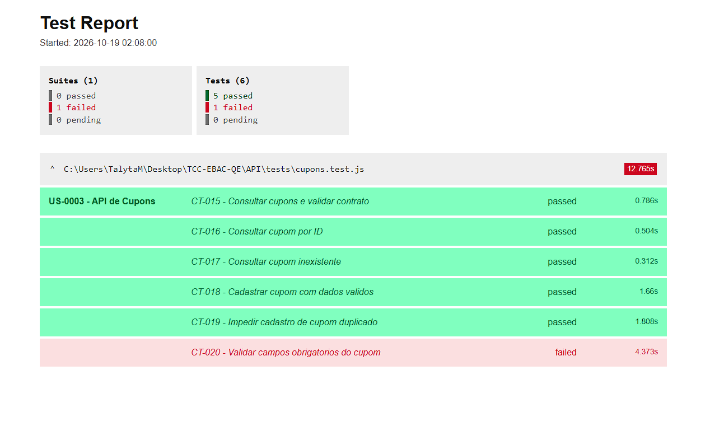

# Testes automatizados de API — EBAC Shop

Automação da **US-0003 — API de Cupons**, desenvolvida para o TCC de Quality Engineering da EBAC.

## Tecnologias

- **Jest** — execução e asserções dos testes
- **Supertest** — requisições HTTP e validações de respostas
- **Node.js** e **dotenv** — execução e variáveis de ambiente
- **jest-html-reporter** — geração de relatório HTML

## Resultado da execução

Em **19/10/2026**, a suíte registrou **6 testes: 5 aprovados e 1 reprovado**, em **16,141 segundos** (tempo total informado pelo Jest). A reprovação histórica corresponde ao **CT-020**, cuja primeira implementação exigia rejeição indevida de campos opcionais. A evidência anterior permanece preservada.

| ID | Cenário | Resultado |
|---|---|---|
| CT-015 | Consultar lista de cupons e validar contrato | Aprovado |
| CT-016 | Consultar cupom existente por ID | Aprovado |
| CT-017 | Consultar cupom inexistente | Aprovado |
| CT-018 | Cadastrar cupom válido | Aprovado |
| CT-019 | Impedir cadastro de código duplicado | Aprovado |
| CT-020 | Validar campos obrigatórios do cupom | **Reprovado (divergência de critério)** |

### Evidência — Relatório HTML do Jest



[Visualizar a evidência no repositório](evidencias/relatorio-jest-api.png)

## Análise do CT-020: campos de cadastro

O teste CT-020 foi programado para esperar rejeição quando qualquer um dos campos `code`, `amount`, `discount_type` e `description` estivesse ausente. A descrição textual da história utilizada na modelagem, porém, indica `code` como obrigatório e os demais campos como opcionais. Por isso, o resultado evidencia uma **inconsistência entre a expectativa adotada pelo teste e a descrição do requisito**, não um defeito confirmado da API.

| Campo ausente | HTTP observado |
|---|---|
| `code` | 400 |
| `amount` | 201 |
| `discount_type` | 201 |
| `description` | 201 |

**Interpretação:** a rejeição por falta de `code` e a aceitação das demais omissões podem estar de acordo com a história que admite campos opcionais. O histórico da execução e a identificação interna BUG-004 foram mantidos para rastreabilidade, mas **não devem ser apresentados como falha confirmada do produto**. A evidência retrata o estado da suíte executada, sem reclassificação artificial do resultado.

## Melhoria pós-avaliação (27/10/2026)

Após o feedback técnico do tutor, o **código do CT-020 foi corrigido** em `tests/cupons.test.js`.

- `code` omitido: espera-se **HTTP 400**, com `code` e `message` de erro.
- `amount`, `discount_type` e `description` omitidos individualmente: espera-se **HTTP 201**, com `id` e estrutura de resposta válidos.
- Em todos os cadastros bem-sucedidos, o cupom é removido em um bloco `finally`, inclusive se alguma asserção falhar.

A captura anterior continua representando a execução de **19/10/2026**; ela não é evidência de execução da versão corrigida. A nova execução com credenciais locais deve ser registrada separadamente, sem substituir os resultados históricos.

**Para validar especificamente a correção:**

```powershell
npx jest tests/cupons.test.js --runInBand -t "CT-020"
```

## Preparação e execução

Na pasta `API`, instale as dependências:

```powershell
npm ci
```

Copie `.env.example` para `.env` e configure os dados de acesso de teste. **Não publique o arquivo `.env`.**

Para executar a suíte completa e gerar o relatório HTML:

```powershell
npm test
```

Para abrir o relatório produzido:

```powershell
Start-Process .\test-report.html
```

Para executar apenas um cenário:

```powershell
npx jest tests/cupons.test.js --runInBand -t "CT-015"
```

O Jest mantém a saída padrão no terminal e gera o arquivo `test-report.html` por meio do `jest-html-reporter`. O HTML gerado é ignorado no Git; a captura de tela fica versionada em `evidencias/`.

**Atenção:** CT-018, CT-019 e CT-020 criam cupons no ambiente remoto. A automação utiliza códigos exclusivos e tenta remover os registros criados ao concluir os testes, em condições normais de execução.

## Organização e segurança

- `tests/cupons.test.js` — seis testes automatizados da US-0003
- `package.json` — comandos e configuração dos reporters
- `evidencias/relatorio-jest-api.png` — captura do relatório
- `.env.example` — modelo de variáveis de ambiente, sem credenciais reais
- `.gitignore` — exclusão de credenciais, dependências e relatórios temporários

**Projeto principal:** [TCC-EBAC-QE](https://github.com/talytam/TCC-EBAC-QE)
