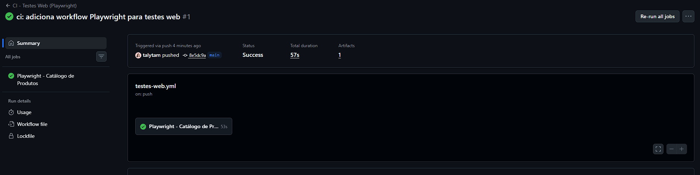
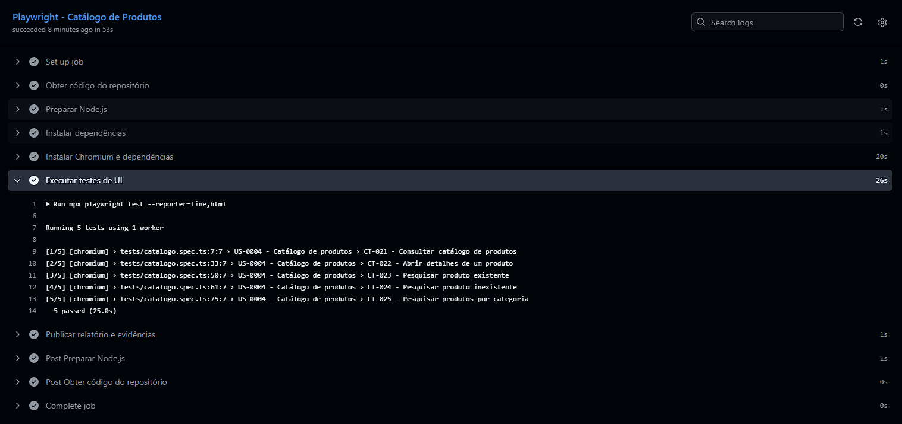

# Integração contínua — GitHub Actions e Playwright

## Objetivo

Automatizar a execução da suíte de **testes Web da US-0004 — Catálogo de Produtos** do TCC de Engenharia de Qualidade de Software da EBAC, utilizando **GitHub Actions** e **Playwright**.

O pipeline executa os testes em um ambiente Linux disponibilizado pelo GitHub, sem depender do computador local, e disponibiliza um relatório HTML para análise da execução.

## Pipeline implementado

**Workflow:** [CI - Testes Web (Playwright)](../.github/workflows/testes-web.yml)  
**Arquivo de configuração:** `.github/workflows/testes-web.yml`  
**Job:** `Playwright - Catálogo de Produtos`  
**Ambiente:** `ubuntu-latest`, Node.js 22 e Chromium.

### Eventos que acionam a execução

- `push` na branch `main`;
- `pull_request` direcionado à `main`;
- acionamento manual pela interface **Actions → CI - Testes Web (Playwright) → Run workflow**.

### Etapas configuradas

1. **Checkout:** obter o código do repositório.
2. **Preparação:** configurar o Node.js e instalar as dependências com `npm ci`, dentro da pasta `UI`.
3. **Navegador:** instalar Chromium e dependências com `npx playwright install --with-deps chromium`.
4. **Execução:** rodar `npx playwright test --reporter=line,html`.
5. **Evidências:** publicar `UI/playwright-report/` e `UI/test-results/` como artefato `relatorio-playwright-ui`, mesmo quando um teste falhar.

O arquivo de configuração limita o job a 20 minutos, e o artefato tem retenção configurada para **14 dias**.

## Resultado — primeira execução

| Indicador | Resultado |
| :--- | :--- |
| Execução | [Workflow #1 — 24/10/2026](https://github.com/talytam/TCC-EBAC-QE/actions/runs/40125899136) |
| Evento | `push` na `main` |
| Status geral | **Success** |
| Job | **Playwright - Catálogo de Produtos — Success** |
| Cenários executados | **5** |
| Cenários aprovados | **5** |
| Cenários reprovados | **0** |
| Tempo dos testes (logs Playwright) | **25,0 segundos** |
| Duração geral da execução (GitHub Actions) | **57 segundos** |
| Artefato | `relatorio-playwright-ui` — publicado com sucesso |

### Cenários executados

| ID | Caso de teste | Resultado |
| :--- | :--- | :--- |
| CT-021 | Consultar catálogo de produtos | Aprovado |
| CT-022 | Abrir detalhes de um produto | Aprovado |
| CT-023 | Pesquisar produto existente | Aprovado |
| CT-024 | Pesquisar produto inexistente | Aprovado |
| CT-025 | Pesquisar produtos por categoria | Aprovado |

Os números foram conferidos nos **logs do job da primeira execução**. Eles representam essa execução específica, não uma garantia de aprovação permanente em execuções futuras.

## Evidências

### Evidência CI-001 — Resultado do workflow

[Visualizar evidência original](../Evidencias/CI/CT-GitHub-Actions-Execucao.png)

### Evidência CI-002 — Resultado dos testes Playwright

[Visualizar evidência original](../Evidencias/CI/CT-GitHub-Actions-Testes.png)

## Como consultar uma execução

1. Acesse a aba **Actions** do repositório.
2. Selecione **CI - Testes Web (Playwright)**.
3. Abra a execução desejada e clique no job **Playwright - Catálogo de Produtos**.
4. Expanda a etapa **Executar testes de UI** para consultar os casos e o resumo de resultados.
5. Na tela de resumo da execução, procure **Artifacts** e baixe `relatorio-playwright-ui`.
6. Extraia o arquivo ZIP e abra o relatório HTML gerado pelo Playwright.

**Atenção:** como o artefato possui retenção de 14 dias, os links do relatório podem expirar. As capturas de tela acima estão versionadas no repositório como evidências permanentes daquela execução.

## Escopo e limitações

Este workflow automatiza **somente a suíte Web/Playwright**. As seguintes atividades **não são executadas por este pipeline**:

- **API (Supertest/Jest):** depende de credenciais de teste; na execução registrada, CT-020 reprovou por divergência entre a expectativa do teste e o tratamento de campos opcionais descrito na história.
- **Mobile — Appium/WebdriverIO:** depende de infraestrutura Android, emulador e servidor Appium. Um cenário mobile permanece bloqueado no registro da suíte.
- **Performance — k6:** foi executada e documentada separadamente, em ambiente local, conforme os resultados de [Performance](../Performance/README.md).

Os testes Web dependem da disponibilidade da loja EBAC utilizada como ambiente de teste, dos seletores e da massa de produtos. Alterações nesses fatores podem afetar futuras execuções.

## Conclusão

A primeira execução do workflow foi **aprovada**, com **cinco cenários Playwright aprovados**, sem testes reprovados, e geração bem-sucedida do artefato de relatório.

A integração contínua da suíte Web está implementada e permite identificar regressões após alterações enviadas à branch principal, respeitadas as dependências do ambiente externo.

---

[Voltar à documentação do projeto](./estrategia-de-testes.md) · [Consultar testes Web](../UI/README.md) · [Repositório TCC-EBAC-QE](https://github.com/talytam/TCC-EBAC-QE)
