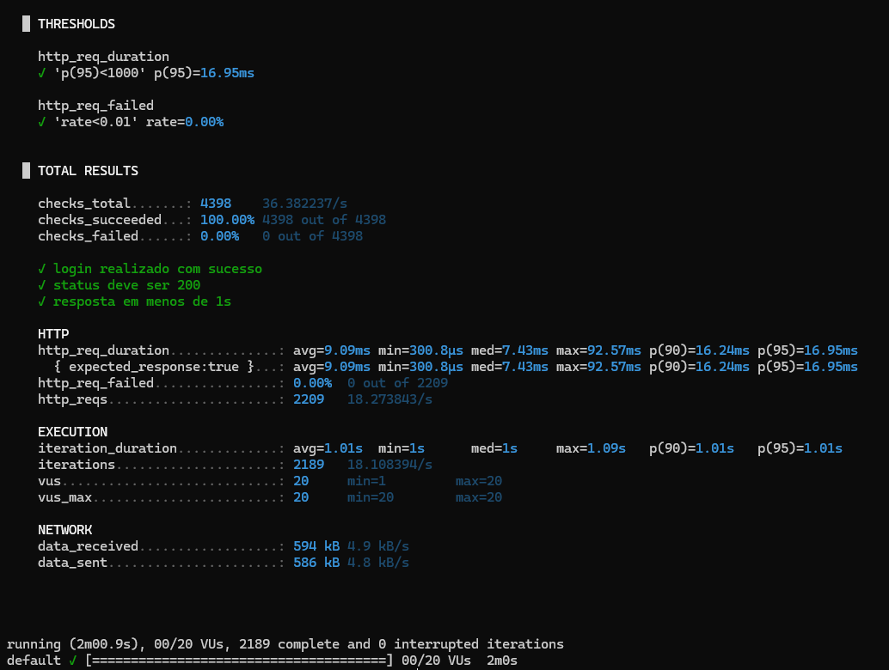
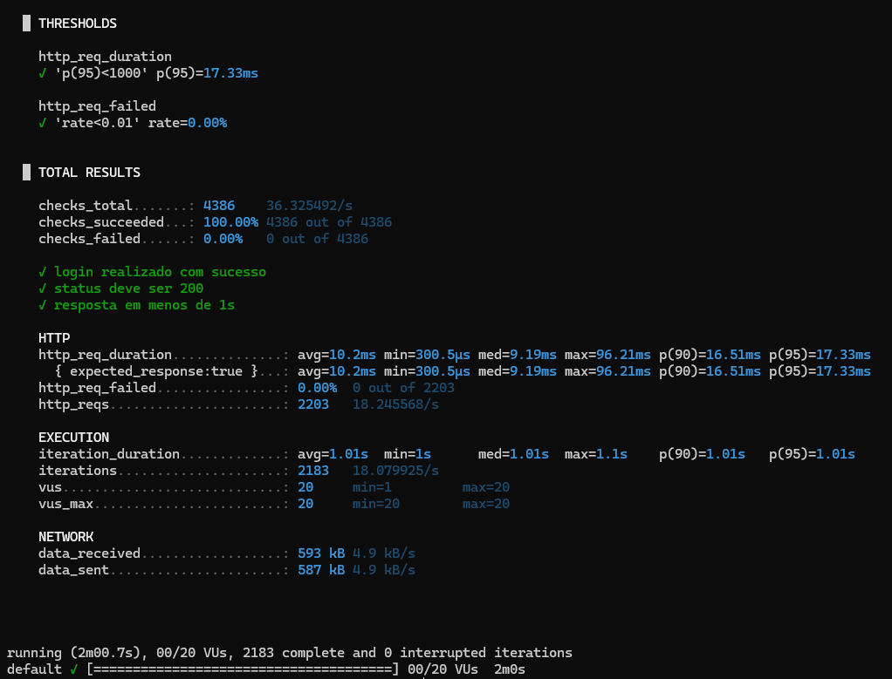

# Testes de Performance | EBAC Demo Store

Automação de testes de carga da **API EBAC Demo Store**, desenvolvida como parte do Trabalho de Conclusão de Curso de **Engenharia de Qualidade de Software da EBAC**.

O projeto utiliza **Grafana k6** para observar o comportamento de endpoints autenticados sob carga concorrente, avaliando o tempo de resposta, a ocorrência de falhas HTTP e as validações funcionais das requisições.

## Resultado das execuções

**2 cenários concluídos, com todos os thresholds e checks aprovados.** Cada cenário foi executado separadamente, com até **20 usuários virtuais (VUs)** e duração programada de **2 minutos**.

| Indicador | Produtos | Clientes |
| :--- | ---: | ---: |
| Endpoint | `GET /api/products` | `GET /api/customers` |
| VUs máximos | 20 | 20 |
| Requisições HTTP | **2.209** | **2.210** |
| Iterações concluídas | 2.189 | 2.190 |
| Tempo médio HTTP | 9,10 ms | 9,52 ms |
| **Tempo de resposta p95** | **16,96 ms** | **17,47 ms** |
| Falhas HTTP | **0%** | **0%** |
| Checks aprovados | **4.398 / 4.398** | **4.400 / 4.400** |
| Checks reprovados | 0 | 0 |
| **Situação** | **Aprovado** | **Aprovado** |

*Fonte: arquivos JSON das execuções finais, em 24/10/2026. Os indicadores HTTP agregam as chamadas de login e de consulta. O teste foi executado em ambiente local; valores arredondados a duas casas decimais.*

## Cenários automatizados

### Cenário 01 — Consulta de Produtos

**Arquivo:** [`produtos.js`](produtos.js)  
**Endpoint:** `GET /api/products`

Valida a autenticação e a consulta do catálogo de produtos durante uma carga progressiva de usuários virtuais.

### Cenário 02 — Consulta de Clientes

**Arquivo:** [`clientes.js`](clientes.js)  
**Endpoint:** `GET /api/customers`

Valida a autenticação e a consulta dos registros de clientes sob a mesma configuração de carga.

Em ambos os cenários, cada VU obtém um token por meio de `POST /api/login` e o reutiliza nas iterações seguintes. O script executa uma consulta por iteração e utiliza `sleep(1)` para introduzir uma pausa de um segundo entre as iterações.

### Validações funcionais

- Login bem-sucedido: resposta HTTP **200 ou 201**.
- Consulta bem-sucedida: resposta HTTP **200**.
- Tempo de cada consulta inferior a **1.000 ms**.
- Armazenamento e reutilização do token de autenticação por VU.

## Ferramentas e ambiente

| Item | Tecnologia / configuração |
| :--- | :--- |
| Ferramenta de carga | Grafana k6 |
| Linguagem | JavaScript |
| Aplicação testada | EBAC Demo Store API |
| Backend | NestJS |
| Banco de dados | PostgreSQL |
| Infraestrutura | Docker e execução local |
| URL padrão | `http://localhost:3000` |
| Autenticação | Bearer Token |

## Configuração dos testes

Os dois scripts utilizam a mesma configuração:

```javascript
export const options = {
  stages: [
    { duration: '20s', target: 20 },
    { duration: '1m40s', target: 20 },
  ],
  thresholds: {
    http_req_failed: ['rate<0.01'],
    http_req_duration: ['p(95)<1000'],
  },
};
```

| Parâmetro | Configuração |
| :--- | :--- |
| Ramp-up | 20 segundos, até 20 VUs |
| Carga constante | 1 minuto e 40 segundos, com 20 VUs |
| Duração total programada | 2 minutos |
| Massa de autenticação | 5 contas de teste |
| Distribuição dos VUs | Até 4 VUs por conta ao atingir 20 VUs |
| Intervalo por iteração | `sleep(1)` |

### Critérios de aceitação

- **Tempo de resposta:** p95 das requisições HTTP inferior a **1.000 ms**.
- **Taxa de falhas:** menos de **1%** das requisições HTTP classificadas como falha.
- **Validações:** login e consultas devem atender às condições verificadas pelos `checks`.

Os thresholds são calculados sobre o conjunto de requisições HTTP de cada script, incluindo os logins iniciais. Portanto, o p95 informado não corresponde exclusivamente ao endpoint GET.

## Como executar

**Pré-requisitos:** k6 instalado, API EBAC Demo Store em execução e as cinco contas `user1_ebac` a `user5_ebac` cadastradas com senha de teste.

Na pasta `Performance`, configure a variável de ambiente usada pelos scripts. No PowerShell:

```powershell
$env:TEST_PASSWORD = Read-Host "Senha das contas de teste"
```

A variável `BASE_URL` é opcional; se não for definida, os scripts utilizam `http://localhost:3000`.

### Produtos

```powershell
k6 run --summary-export="evidencias/resultado-produtos.json" produtos.js
```

### Clientes

```powershell
k6 run --summary-export="evidencias/resultado-clientes.json" clientes.js
```

Os testes são independentes e devem ser executados separadamente. Cada comando exibe o resumo no terminal e salva os indicadores consolidados no respectivo JSON.

**Segurança:** a senha é fornecida em tempo de execução, não é armazenada nos scripts nem deve ser versionada no repositório.

## Evidências

### Evidência 01 — Produtos



[Visualizar captura de tela](evidencias/CT-Performance-Produtos.png) · [Consultar resultado JSON](evidencias/resultado-produtos.json)

**Resultado:** 2.209 requisições HTTP, p95 de 16,96 ms, nenhuma falha HTTP e 4.398 checks aprovados.

### Evidência 02 — Clientes



[Visualizar captura de tela](evidencias/CT-Performance-Clientes.png) · [Consultar resultado JSON](evidencias/resultado-clientes.json)

**Resultado registrado no JSON:** 2.210 requisições HTTP, p95 de 17,47 ms, nenhuma falha HTTP e 4.400 checks aprovados.

> **Observação de rastreabilidade:** em caso de divergência numérica entre uma captura de terminal e o JSON disponível nesta pasta, considere-os registros de execuções distintas. Os indicadores da tabela principal foram extraídos dos **arquivos JSON versionados**.

## Estrutura do diretório

```text
Performance/
├── README.md
├── produtos.js
├── clientes.js
└── evidencias/
    ├── CT-Performance-Produtos.png
    ├── CT-Performance-Clientes.png
    ├── resultado-produtos.json
    └── resultado-clientes.json
```

## Análise e conclusão

Nos dois cenários, o limite de 20 usuários virtuais foi atingido e os thresholds definidos nos scripts foram atendidos. As execuções registraram **0% de falhas HTTP** e **100% dos checks aprovados**, sem evidências de degradação acima dos limites estabelecidos.

Os resultados indicam desempenho satisfatório **para o ambiente, a massa de dados, o volume de carga e a duração avaliados**. Como as execuções ocorreram localmente e por um período delimitado, elas não demonstram, por si só, capacidade de produção, escalabilidade além dos 20 VUs ou resistência a cargas prolongadas.

---

**Projeto principal:** [TCC-EBAC-QE](https://github.com/talytam/TCC-EBAC-QE)
